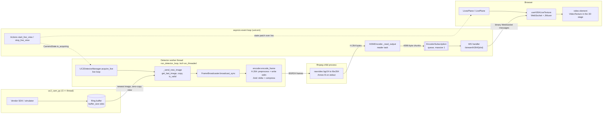
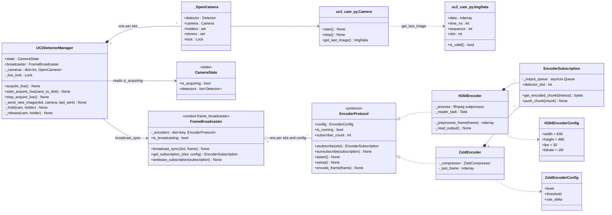
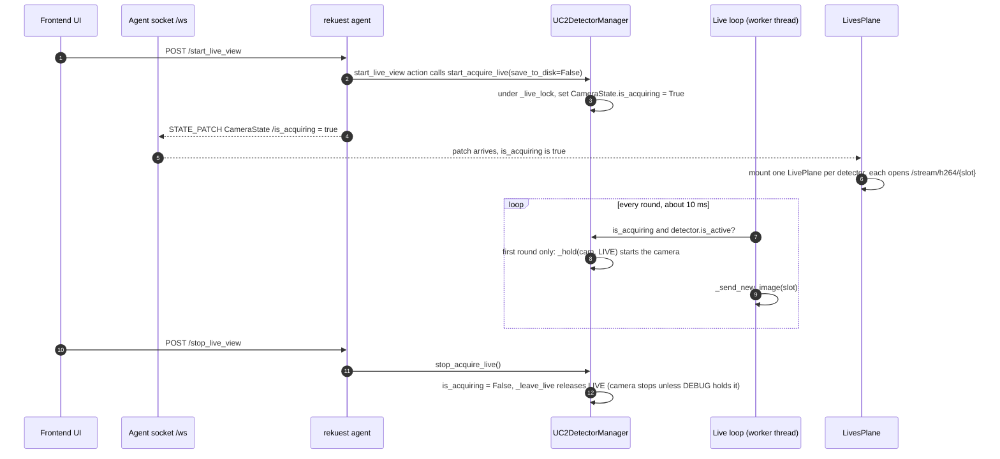
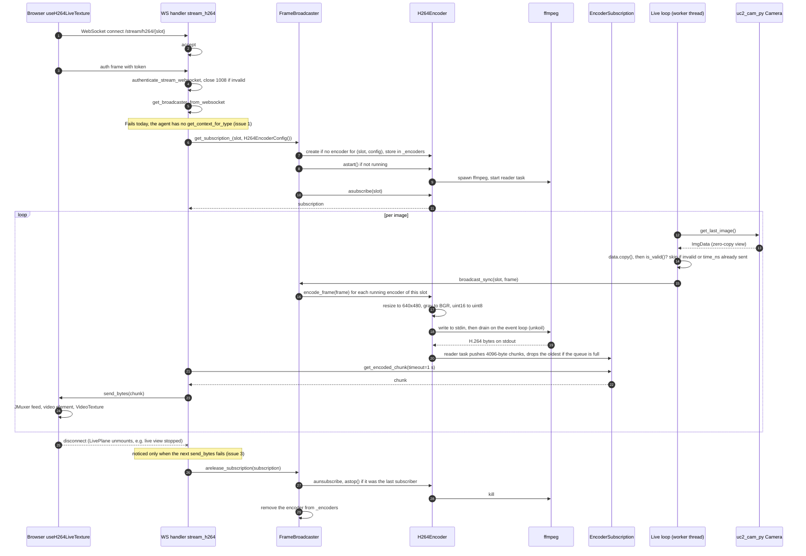
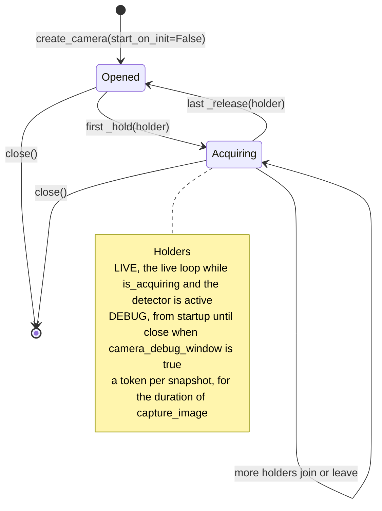
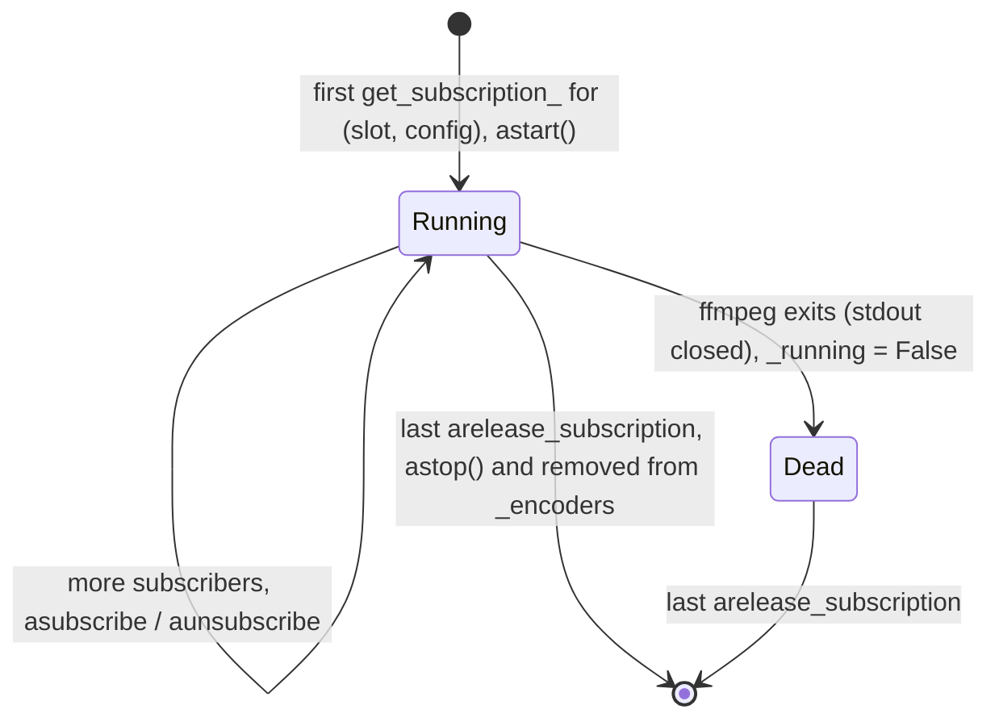

# Live image pipeline: from uc2_cam_py to the browser

How one camera image travels from the uc2_cam_py ring buffer to the frontend's live view:
which code touches it, on which thread, in which format, and where it can be dropped. It
describes the code as of 2026-10-27, including what is broken (see
[Known issues](#8-known-issues-as-of-2026-10-27)).

Scope: the **live stream**. Snapshots (`capture_image`) take another route: through
`AcquistionManager` into the cache (zarr), served over HTTP by `/cache`. They are not covered
here.

Paths are relative to the repository root. Line numbers are from 2026-10-27; the function
names are the stable reference.

---

## 1. Overview

- Pixels never travel through the agent socket `/ws` or the states. `/ws` carries only the
  *control*: the actions `start_live_view` / `stop_live_view` and the state
  `CameraState.is_acquiring`. The pixels go through a separate WebSocket per detector slot,
  `/stream/h264/{slot}` (or `/stream/zstd/{slot}`).
- The camera acquires on its own C++ thread. A Python **live loop** picks up the newest image
  and hands it to the **`FrameBroadcaster`**.
- The broadcaster feeds it to every **encoder** running for that slot. One encoder exists per
  `(slot, encoder config)` and is shared by every client with that config.
- The H.264 encoder pipes the frames through an **ffmpeg** child process. Its output is cut
  into chunks, queued per **subscription**, and sent by the WebSocket handler.
- Encoders exist only while a client is subscribed. With no client connected, the live loop
  still reads images, but `broadcast_sync` has nobody to give them to.

---

## 2. Components and threads

| Thread / process | Runs | Started by |
| --- | --- | --- |
| uc2_cam_py acquisition (C++) | fills the ring buffer while the camera is held | `Camera.start()` in `_hold` |
| Detector worker thread | `acquire_live` until shutdown, `broadcast_sync`, `encode_frame` | background hook `run_detector_loop` (`backend/newswitch/app.py:641`) |
| asyncio event loop | actions' dispatch, WS handlers, ffmpeg reader task, subscription queues | uvicorn |
| ffmpeg | H.264 encoding | `H264Encoder.astart`, when the first client subscribes |
| Browser | decoding and display | `LivesPlane` mounts while `is_acquiring` is true |

`run_detector_loop` is a synchronous `@background` function. rekuest_next runs such functions
through koil's `run_threaded`, so the whole live loop, and with it the encoders'
`encode_frame`, runs on that worker thread, not on the event loop.

---

## 3. Classes involved

Where they live:

| Class | File |
| --- | --- |
| `UC2DetectorManager`, `_OpenCamera` | `backend/newswitch/managers/uc2/uc2_detector.py` |
| `Camera`, `ImgData` | uc2_cam_py (`camera.py`, `data.py`), extra `camera` |
| `CameraState`, `Detector` | `backend/newswitch/protocols/detector.py` |
| `FrameBroadcaster` | `backend/newswitch/broadcasters/frame.py` |
| `EncoderProtocol`, `EncoderSubscription`, configs | `backend/newswitch/broadcasters/encoders/{base,subscription,config}.py` |
| `H264Encoder`, `ZstdEncoder` | `backend/newswitch/broadcasters/encoders/{h264,zstd}_encoder.py` |
| WebSocket routes | `backend/newswitch/routes/ws/liveview.py`, mounted under `/stream` (`app.py:737`) |

There is exactly one `FrameBroadcaster`: `provide_managers` creates it (`app.py:374`), hands
it to the detector manager (`app.py:509`) and returns it as the agent context
`frame_broadcaster` (`app.py:574`). The stream routes have to get that same instance from the
agent.

---

## 4. Starting the live view

The frontend starts the stream with an action and learns about it through the state.

Notes:
- `activate_detector` alone starts nothing. A detector streams when it is active **and**
  `CameraState.is_acquiring` is set. `deactivate_detector` takes it out of the stream
  (`_leave_live`).
- `LivesPlane` mounts a `LivePlane` for every detector in `CameraState.detectors` (up to
  ten), active or not, so it also opens sockets for inactive detectors.
- `start_live_view_and_save_to_disk` follows the same path; it also switches on writing to
  disk (`_store`), which does not affect the stream.

---

## 5. Subscribing and one image end to end

---

## 6. Lifecycles

### Camera acquisition: holders

A camera acquires while at least one *holder* holds it (`_hold` / `_release`). The first
holder starts it, the last one stops it.

With `camera_debug_window: true` (default in `backend/base_config.yaml`), every camera is held
from startup on (`uc2_detector.py:243`). It acquires before anyone logs in, independent of
the live view.

### Encoder

Because encoders exist only between the first subscription and the last release, an empty
`FrameBroadcaster._encoders` means that no client is subscribed at that moment.

---

## 7. Stage by stage

| # | Stage | Code | Format afterwards | Rate / buffering |
| --- | --- | --- | --- | --- |
| 1 | Acquisition | uc2_cam_py C++ thread | ring buffer slots, `(H, W)` mono or raw Bayer, `(H, W, 3)` color; `uint8` for 8-bit pixel formats, else `uint16` | camera frame rate; the ring overwrites the oldest slot |
| 2 | Pick-up | `UC2DetectorManager._send_new_image` (`uc2_detector.py:630`) | own copy of the newest image (`data.copy()`), sent only if `is_valid()` after the copy and if its `time_ns` was not sent before | one image per detector per loop round; images between two rounds are skipped |
| 3 | Loop pacing | `acquire_live` (`uc2_detector.py:596`) | – | `koil.sleep(LIVE_INTERVAL_S = 0.01)` while streaming, `IDLE_INTERVAL_S = 0.1` otherwise, `RETRY_INTERVAL_S = 1.0` after an error; in practice koil oversleeps (about 140 ms, see OP #3) |
| 4 | Fan-out | `FrameBroadcaster.broadcast_sync` → `_schedule_encoder_frames` (`frame.py:136`) | same array, to each running encoder of the slot | synchronous, in the worker thread |
| 5a | H.264 pre-processing | `H264Encoder._preprocess_frame` (`h264_encoder.py:152`) | resized to 640×480, gray → BGR, `uint16` → `uint8` by `/256` | – |
| 5b | H.264 encoding | ffmpeg: `-f rawvideo -pix_fmt bgr24 -s 640x480 -r 30 -i -`, `libx264 -profile baseline -preset ultrafast -tune zerolatency -g 30 -b:v 1M`, `-f h264 -` | H.264 Annex B byte stream | keyframe every 30 frames; ffmpeg assumes 30 fps |
| 6 | Chunking | `H264Encoder._read_output` (`h264_encoder.py:123`) | 4096-byte pieces of the byte stream, not aligned to frames | reader task on the event loop |
| 7 | Queue | `EncoderSubscription.push_chunk` (`subscription.py`) | – | `asyncio.Queue(maxsize=1)`; when full, the oldest chunk is dropped |
| 8 | Send | `stream_h264` (`liveview.py:128`) | one binary WebSocket message per chunk | waits up to 1 s per chunk, then waits again; idles while `is_broadcasting` is false (set once when `acquire_live` starts, never cleared) |
| 9 | Display | `useH264LiveTexture` (`frontend/src/components/stage/hooks/useH264LiveTexture.tsx`) | JMuxer (MSE, `fps: 30`) → `<video>` → three.js `VideoTexture` on a plane of 1024 µm | – |

**Zstd instead of H.264** (`/stream/zstd/{slot}`, config `level=1, threshold=0.0,
use_delta=True`): `ZstdEncoder.encode_frame` works synchronously in the worker thread. It
converts the frame to `float32`, subtracts the previous frame (delta; differences below
`threshold` become 0), compresses with zstd and pushes the chunk (one per frame) to the
subscriptions. No child process. The frontend has a hook for it (`useLiveZstdTexture`), but
nothing uses it.

**Virtual detector as the source**: with `use_virtual_microscope: true`,
`VirtualDetectorManager.acquire_live` renders a frame per active detector, paced by its
frame rate, and calls the same `broadcast_sync` (`virtual_detector.py:1007`). Everything
from stage 4 on is identical.

**Frontend consumer**: the active path is `IndexPage` → `Expanse` → `LivesPlane` (renders
only while `cameraState.is_acquiring`) → `LivePlane` per detector → `useH264LiveTexture`. The
URL is `VITE_BACKEND_URL + "/stream/h264/" + slot`, or `window.__agent_url__` in place of
`VITE_BACKEND_URL` when the Electron app injects it (`frontend/src/constants.tsx`). Right
after `onopen` the hook sends the auth frame (`authFrame()`, the token). A close with code
1008 logs the user out.

---

## 8. Known issues (as of 2026-10-27)

Tracked in `.claude/OpenPoints.md`.

1. **The stream route crashes on every connection (OP #28).**
   `get_broadcaster_from_websocket` (`liveview.py:75`) calls `agent.get_context_for_type(...)`,
   which rekuest_next 2.3.1 does not have (it offers `agent.contexts[key]` /
   `aget_context(key)`; the key is `frame_broadcaster`). The handler raises `AttributeError`
   before `get_subscription_`. No encoder is ever created, and no image reaches the frontend.
   Reproduced with camTest: 0 encoders and 0 bytes with a connected, authenticated client.
   `tests/test_auth.py` only tests the rejected path.
2. **ffmpeg's stderr is never read (OP #29).** `stderr=PIPE` (`h264_encoder.py:118`) without a
   reader: ffmpeg writes progress lines continuously, and once the pipe buffer (about 64 KB) is
   full, ffmpeg blocks and the stream freezes.
3. **Further risks (OP #30):**
   - Thread safety. `encode_frame` runs on the worker thread: H.264 calls
     `StreamWriter.write` there, Zstd calls `asyncio.Queue.put_nowait`. Neither is thread-safe.
   - Dropped H.264 chunks. The queue keeps one 4096-byte chunk and drops the oldest. Dropping
     part of an H.264 byte stream corrupts the picture until the next keyframe (up to 30
     frames).
   - Late release. After the auth frame the handler never reads from its socket, so it
     notices a closed connection only when `send_bytes` fails. If the client leaves after the
     frames stopped (live view stopped), the subscription, the encoder and ffmpeg stay until
     frames flow again.
   - Aspect ratio. Every frame is resized to 640×480, regardless of the sensor or ROI.
   - Dark 10/12-bit images. `uint16` → `uint8` divides by 256, which suits 16-bit data.
     Mono10/Mono12 values (≤ 1023/4095) end up at ≤ 3/15.
   - Zstd format mismatch. The backend sends `float32` deltas; `useLiveZstdTexture` expects
     `uint8` full frames (unused today).
   - Dead frontend code. `components/microscope/LiveView.tsx` is not mounted anywhere; its
     `StreamingView` connects to `VITE_WEBSOCKET_URL + "/video"`, a route that does not exist.
4. **Frame rate limited by `koil.sleep` (OP #3).** The live loop's 10 ms pause takes about
   140 ms, which limits the stream to about 7 fps.

---

## 9. Debugging

- **Is a client subscribed?** `FrameBroadcaster.encoder_count` or `_encoders`. Breakpoints in
  `get_subscription_` (`frame.py:88`) and `arelease_subscription` (`frame.py:119`) show
  whether a client arrives and when it leaves. A breakpoint in `_schedule_encoder_frames`
  pauses every thread on each frame. While it is paused, the event loop cannot complete a
  subscription.
- **Does the live loop deliver?** Breakpoint in `_send_new_image`, or on the
  `is_acquiring and detector.is_active` check in `acquire_live`.
- **Backend errors of the stream route** (tracebacks, `Stream error: ...`) appear in the
  backend's output. With `backend_cli.py` that is `backend/data/backend_cli.log`, unless
  `--verbose` is given.
- **Browser side:** DevTools → Network → WS: is there a connection to `/stream/h264/<slot>`,
  on the right port, and with which close code? 1006 (no close frame) points to a
  server-side exception, 1008 to a rejected token.
