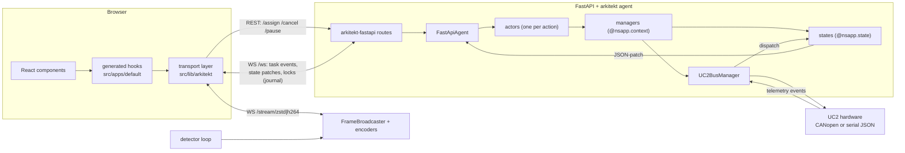
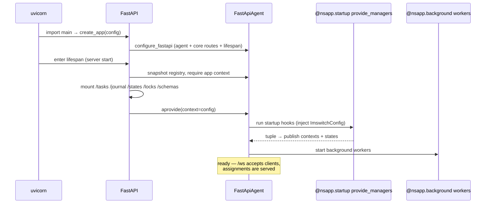

# newswitch Architecture & Developer Guide

*How the backend, the arkitekt stack, and the frontend fit together. Written
against `arkitekt` 8.0.0, `arkitekt-runtime` 5.0.0, `arkitekt-spec` 3.18.0 and
`arkitekt-fastapi` 2.1.0, pinned exactly in `backend/pyproject.toml`
(2026-10). newswitch was built on rekuest-next before; that stack is gone.
File references are relative to the repo root.*

---

## 1. The big picture

newswitch is a FastAPI app whose entire functional surface is managed by an
**arkitekt agent** embedded in the server. Nothing in the backend defines
REST endpoints for microscope features by hand. Instead, everything is declared
on one app object, `nsapp = App("newswitch", app_context=ImswitchConfig)`
(`backend/newswitch/arkitekt_app.py`):

- **functions** decorated with `@nsapp.action` become remotely callable **actions**,
- **data classes** decorated with `@nsapp.state` become **reactive shared state**
  that is pushed to every browser as JSON-patches,
- **service classes** marked with `@nsapp.context` (the "managers") are
  **dependency-injected** into those functions by type annotation,
- the frontend **generates typed React hooks** from the running backend's
  schema endpoints, so UI code never hand-writes API calls.

| Package | What newswitch uses from it |
|---|---|
| `arkitekt` | the `App` facade (`nsapp`), `Task`, `OptimisticInput`, `bsx`, `withValidator`, `model_field` |
| `arkitekt-runtime` | the agent, actors, locks, evented states, the journal |
| `arkitekt-spec` | the declarations (implementations, state/lock schemas, ports) |
| `arkitekt-fastapi` | the served agent: `configure_fastapi`, `/ws`, `/schemas/*`, journal routes, `AsyncAgentTestClient` |



---

## 2. arkitekt concepts, one by one

### 2.1 Agent and actors

arkitekt uses the classic **actor model**. Translated to newswitch:

- The **Agent** (`FastApiAgent`, created by `configure_fastapi` from
  `arkitekt_fastapi` in `backend/newswitch/app.py:create_app`) is the *runtime
  container* for the whole app. It does not do microscope work itself. It owns:
  - `contexts: dict` — the live manager instances (everything
    `@nsapp.context`), keyed by name (routes look them up by class with
    `newswitch/routes/contexts.py: context_of_type(agent, cls)`),
  - `states: dict` — the live state instances (everything `@nsapp.state`),
    each with a revision counter and a serialized ("shrunk") copy,
  - `locks: dict` — named task locks (e.g. `stage_position`),
  - the **implementation map** — one entry per declared action,
  - the startup/shutdown hooks and background workers,
  - all running **assignments** (tasks) and the actors executing them,
  - the **journal** and a SQLite store (`arkitekt_agent.db`, `db_path` in
    `backend/base_config.yaml`) that persists it. The old `agent_data.db` of
    the rekuest-next days cannot be read by the new store.
- An **actor** is the execution vehicle for one implementation. When a client
  *assigns* a task ("run `move_stage` with these args"), the agent routes the
  assignment to the actor for that implementation, which runs the function
  (sync functions in a worker thread via koil, async ones on the loop) and
  reports lifecycle events back (`STARTED`, `PROGRESS`, `YIELD`, `PAUSED`,
  `HELD`, `CANCELLED`, `COMPLETED`, `FAILED`).

In upstream Arkitekt, the agent connects out to an arkitekt server and receives
assignments from there. In newswitch, **arkitekt-fastapi** replaces that
transport: the agent lives inside uvicorn and browsers talk to it directly over
`/ws` + a few REST routes. Same model, no external server.

### 2.2 The app context

`App("newswitch", app_context=ImswitchConfig)` declares which class is the
**app context**: the one settings object of a deployment. `ImswitchConfig`
lives in `backend/newswitch/config.py` (a pydantic-settings class reading
`backend/base_config.yaml`). There is no marker decorator anymore; the
declaration on the `App` is all there is.

The object you pass as `app_context=` into `configure_fastapi` travels into
`agent.aprovide(context=...)` and becomes **injectable by type** into hooks and
actions. That's why `provide_managers(app_context: ImswitchConfig)` receives
the config. The served app refuses to start without one: the lifespan calls
`require_app_context` before the agent is entered.

### 2.3 `@nsapp.startup` — the composition root

```python
@nsapp.startup
async def provide_managers(app_context: ImswitchConfig) -> Tuple[FrameBroadcaster, UC2BusManager, ..., StageState, ...]:
```

Startup hooks run **once, when the agent boots** (inside `aprovide`, before
anything is callable). Two pieces of magic, both driven purely by type
annotations:

1. **Parameter inspection**: each parameter is matched by its annotated type
   against (a) the app-context class, (b) already-published state classes,
   (c) already-published context classes. Matching objects are injected.
2. **Return annotation → publication**: the `Tuple[...]` return annotation
   tells the agent what each returned object *is*. Objects whose class/protocol
   is a context go into `agent.contexts`; objects whose class is a state go
   into `agent.states` (serialized, revision 0, immediately subscribable).

So `provide_managers` is the **composition root**: everything it returns is
"published for the rest of the agent lifecycle" and becomes injectable into
every action, background worker and shutdown hook. If you build a new manager
and forget to add it to both the return *value* and the return *annotation*,
injection will fail with `StateRequirementsNotMet` at call time.

**context dependency** = "give me the live manager instance of this type"
(e.g. `stage: StageManager`). **state dependency** = "give me the live shared
state instance" (e.g. `state: StageState`). Contexts are never serialized;
states are.

`@nsapp.shutdown` hooks run when the agent tears down, after background
workers and running tasks are cancelled: `save_device_config` writes runtime
values back into the device config, `close_detector` releases the cameras.

### 2.4 `@nsapp.action` — actions

Any function becomes a remotely callable action:

```python
@nsapp.action(optimistics=[OptimisticInput(state="StageState", path="/x", accessor="/x"), ...])
def move_stage(stage: StageManager, task: Task, x: float | None = None, ...) -> None:
    stage.move(x=x, ..., task=task)
```

- Parameters that are contexts/states are injected (invisible to callers);
  everything else becomes the action's *argument schema* (a "port"), which is
  what the frontend codegen turns into a zod schema.
- **Progress and pause**: there is no ambient `progress()`/`pausepoint()`.
  An action takes an injected `task: Task` (from `arkitekt`) and calls
  `task.progress(pct, msg)` and `task.pausepoint()` — that's what powers the
  live progress bar and the pause/step buttons. Managers that report progress
  receive the task explicitly (`StageManager.move(..., task: Optional[Task] = None)`).
  Tests calling an action directly pass `Task.local()`.
- `locks=[...]` declares the action's locks explicitly; otherwise they are
  inferred from the contexts/states it takes (see 2.6 and section 5).
- `optimistics=[...]` describes how the UI should *predict* the state change
  before the backend confirms (instant slider/position feedback). `path` and
  `accessor` are JSON pointers.
- **Validators** on arguments are blok UtilCalls built with
  `withValidator("len(value) > 0", error_message=...)` (see
  `newswitch/routines/multidimensional_acquisition.py`); the frontend
  evaluates them in `frontend/src/lib/arkitekt/calls.ts`.
- Declarations happen at **import time** onto `nsapp` — which is why `app.py`
  imports `newswitch.registers.uc2` and the routines for their side effects.
  `nsapp.register_action(fn)` is the explicit spelling for functions defined
  elsewhere.

### 2.5 `@nsapp.background` — daemons

`@nsapp.background` functions are long-running workers started right after
the startup hooks (async ones run on the event loop, sync ones in a dedicated
thread). They use the same injection: `run_uc2_bus(uc2_bus: UC2BusManager)`
gets the live bus. newswitch has three: the detector acquisition loop, the UC2
bus connection pump, and the UC2 event → state dispatcher.

### 2.6 The class decorators

| Decorator | What it does |
|---|---|
| `@nsapp.context(locks=[...])` | Marks a class (usually a `Protocol`) as an **injectable service** ("manager"). `locks=[...]` are the locks every action taking this context holds. |
| `@nsapp.state(required_locks=[...])` | Introspects the class into a **state schema** (ports per field) and makes instances *evented*: every `setattr` applies the change under the state's own RLock and publishes a JSON-patch with a new revision to all subscribers. `required_locks` are the locks every action taking this state holds; writes themselves are not checked against locks. |
| `@nsapp.model` | Marks a dataclass as a **serializable data structure** so it can appear inside action arguments/returns and state fields. Its identifier is `@newswitch/<snake_name>`. Used for config/value objects (`StageConfig`, `Illumination`, `UC2CanBusConfig`, …). No reactivity. Enums travel by member name (`"SEQUENTIAL"`). |
| `@runtime_checkable` | Python stdlib `typing`, not arkitekt — allows `isinstance(obj, SomeProtocol)` structural checks, which the tests use (`isinstance(bus, UC2BusManager)`). |

### 2.7 The app registry and bloks

`nsapp.registry` is the **AppRegistry** of the app — the accumulator for
everything above (implementations, state schemas, locks, bloks, hooks). There
is no global default registry anymore; every declaration goes through `nsapp`:

```python
nsapp.register_action(acquire_multidimensional_acquisition)
nsapp.register_action(scan_region)
```

You can register **any function** whose non-injected parameters are
serializable types — that's how a new "app" (in the ImSwitch sense) gets its
backend surface. When the server starts, the agent serves a validated, frozen
**snapshot** of the registry.

`nsapp.blok(name, bsx(...))` is different: it ships a **server-defined UI
fragment** written in a JSX-like markup. Bloks are served at
`/schemas/bloks`, generated into `frontend/src/apps/default/bloks.ts` by the
codegen, and rendered by the frontend's blok renderer. Bloks can bind to states
(`@self.ObjectiveState.mounted_lenses`), loop (`<foreach>`), and invoke actions
(`onClick="@self.switch_objective(lens.slot)"`). Use them for small panels that
shouldn't require a frontend build.

**"jonda"** is simply the (arbitrary) name of a demo blok Johannes left in
`app.py` — the card even says *"Bene don't look at this yet, this is just a
placeholder"*. It demonstrates the binding syntax; it can be renamed or removed
freely.

---

## 3. Boot lifecycle, step by step

What happens when you run `uvicorn main:app --port 8099`:

1. **Import time** (`main.py` → `newswitch.app`): importing `app.py` (and the
   protocol, register and routine modules it imports) executes every
   `@nsapp.*` decorator — `nsapp.registry` fills up. `main.load_config()`
   optionally reads `NEWSWITCH_CONFIG` and `create_app(config)` runs.
2. **`create_app`** builds the FastAPI app, adds auth and CORS middleware,
   then calls
   **`configure_fastapi(app=app, app_registry=nsapp.registry, expand_user_from_request=..., app_context=config, db_file=config.db_path)`**
   which:
   - constructs the `FastApiAgent` with the registry + SQLite sink/retriever,
   - mounts the *core* surface immediately: `/ws` (the single multiplexed
     websocket for task events, state patches and lock events) plus
     `/assign`, `/cancel`, `/pause`, `/resume`, `/step`,
   - builds a **lifespan** context manager and installs it via
     **`app.router.lifespan_context = lifespan`**. This is plain FastAPI
     machinery: the lifespan is an async context manager that uvicorn enters
     after binding the port ("startup") and exits on shutdown. arkitekt-fastapi
     *replaces* the app's default lifespan so agent boot/teardown ride on the
     server's own lifecycle.
3. Back in `create_app`, the non-agent routers are mounted: auth/users,
   `/stream/*` (video websockets), file and cache HTTP routes.
4. **Server startup → lifespan enters**:
   - the agent swaps its registry for a frozen snapshot and checks the app
     context is there (`require_app_context`),
   - the remaining route groups are mounted (`/tasks`, the journal routes,
     `/states`, `/locks`, per-implementation execution routes, `/assets`, and
     the **schema routes** the frontend codegen reads:
     `/schemas/implementations`, `/schemas/states`, `/schemas/locks`,
     `/schemas/bloks`, `/schemas/assets`),
   - OpenAPI is configured, `app.state.agent = agent`,
   - `async with agent:` opens the agent, then **`agent.aprovide(context=config)`**
     is spawned as a task. `aprovide`:
     1. runs every **startup hook** (→ `provide_managers` builds all
        managers/states, chooses virtual vs UC2 transport from the config),
     2. publishes the returned contexts and states,
     3. starts every **background worker** (detector loop, `run_uc2_bus`,
        `run_uc2_event_dispatch`),
     4. begins serving assignments.
5. **Shutdown** reverses it: the provide task is cancelled → background tasks
   cancelled (that's the `CancelledError` path your bus `abackground` must
   re-raise) → running tasks cancelled → **shutdown hooks** run
   (`save_device_config`, `close_detector`) → agent closes → app exits.



---

## 4. Request lifecycle (what a button press does)

1. A component calls a generated hook (`useMoveStage().call({x: 100})`).
2. The transport POSTs to **`/assign`** with the implementation name and args;
   the args were validated client-side against the generated zod schema (and
   any `withValidator` calls).
3. The agent records the assignment and hands it to the actor. If another
   running action holds one of the action's **locks**, it waits until that
   lock is released; then the function body runs with its contexts/states and
   `task` injected.
4. Lifecycle events (`STARTED`, `PROGRESS`, …) and `LOCK`/`UNLOCK` frames
   stream to every subscribed client over **`/ws`**; the UI's
   `ProgressDisplay`/lock indicators react. Other clients see the task too
   (`ASSIGN`).
5. Any state mutation inside the call (or from elsewhere, e.g. the UC2
   dispatcher writing `StageState.x`) is JSON-patched over the same socket.
6. Cancel/pause/step buttons hit `/cancel`, `/pause`, `/step`;
   `task.pausepoint()` in the function body is where pauses take effect;
   cancellation raises `CancelledError` inside the body (the UC2 bus turns
   that into a hardware stop command).
7. Every event lands in the **journal**, persisted to SQLite (→ `/replay`).

---

## 5. State, locks and the journal

- A state instance is a normal Python object — **mutating an attribute is
  the entire API** (`stage_state.x = 42.0`). The evented subclass publishes
  `{op: replace, path: /x, value: 42.0, rev: n}` to the agent, which fans it
  out to `/ws` subscribers; each frontend zustand store applies patches in
  revision order. Thread safety of the write is the state's own RLock.
- **Locks are action locks, nothing else.** An action's locks are its
  explicit `locks=` or are inferred from the contexts/states it takes (a
  state's `required_locks`, a context's `locks`). They do two things: an
  action waits until no other running action holds the same lock (real
  mutual exclusion — command exclusivity over a device for a whole
  multi-step operation), and the UI is told (`LOCK`/`UNLOCK`) so it can
  disable conflicting actions.
- **State writes are not checked against locks.** Managers, background loops
  (the UC2 event dispatch) and shutdown hooks write states freely. Writes made
  inside an action through the injected state are attributed to the task
  (the patch carries its `task_id`) and are refused after the task ended;
  writes made by managers/hooks directly carry no task id.
- `optimistics=[OptimisticInput(state=..., path="/x", accessor="/x")]` on
  `@nsapp.action` lets the UI apply a *predicted* patch immediately when the
  call is made; the real patch reconciles it.
- The **journal** is one ordered record per agent session. Every entry has a
  `pos` (1, 2, 3 … no gaps), a `global_rev`, a `kind`, a `task_id`, …; the
  world at any position is states + tasks + locks. It is served at
  `/journal`, `/journal/{session}`, `/journal/{session}/at/{pos}`,
  `/journal/{session}/at?timestamp=…` and `/tasks/{id}/events`. (The older
  `/states/checkout`, `/states/segments` and session boundary routes still
  exist, but the frontend no longer uses them.)

---

## 6. Video streaming (separate from /ws)

Bulk pixels never travel through the state system. The detector background
loop pushes frames into the **`FrameBroadcaster`** (`backend/newswitch/broadcasters/`),
which owns shared encoders (zstd, H.264) keyed by `(slot, config)`. Browsers
open `WS /stream/zstd/{slot}` or `/stream/h264/{slot}`
(`backend/newswitch/routes/ws/liveview.py`) and decode with `fzstd`/`jmuxer`
(`frontend/src/components/liveview/StreamingView.tsx`). Scan/acquisition code
can broadcast into additional slots (e.g. stitched-map tiles).

---

## 7. Module reference (backend)

| Path | Role |
|---|---|
| `newswitch/arkitekt_app.py` | The one app object: `nsapp = App("newswitch", app_context=ImswitchConfig)`. Every declaring module imports it. |
| `newswitch/config.py` | `ImswitchConfig` (the app context), read from `base_config.yaml`. |
| `newswitch/app.py` | App assembly: `provide_managers` (`@nsapp.startup`), shutdown hooks, background workers, most actions, blok demos, `create_app` (`configure_fastapi`). |
| `newswitch/protocols/` | The **contracts**: per-domain `Protocol` (`@nsapp.context`) + `@nsapp.state` classes. `stage.py`, `illumination.py`, `detector.py`, `objective.py`, `filter_bank.py`, `uc2.py` (bus protocol + typed hardware events), `autofocus.py`, `light_path.py`/`core.py` (Kube/light-path optics model), `expanse.py`, `io.py`, `hook_manager.py`, `metadata.py`, `calibration.py`, `acquistion_manager.py`, `cache.py`. |
| `newswitch/managers/virtual/` | Full simulation implementations (stage, LED, detector with synthetic PSF, objective, filter bank). |
| `newswitch/managers/uc2/` | Real hardware: `canopen_bus.py` / `rest_bus.py` / `virtual_bus.py` (transports behind `UC2BusManager`), `event_broker.py` (fan-out), `dispatch.py` (events → states), plus bus-based device managers (`stage_manager.py`, `illumination_manager.py`, `objective_manager.py`, `filter_bank_manager.py`, `galvo_scanner.py`). |
| `newswitch/registers/` | Standalone `@nsapp.action` modules (imported for side effects), e.g. `uc2.py` (home/stop/laser/LED/galvo/node-scan actions). |
| `newswitch/routines/` | Multi-step procedures registered as actions: `region_scan.py`, `multidimensional_acquisition.py`, `calibration.py`, `autofocus.py`. The template for porting ImSwitch "apps". |
| `newswitch/hooks/` | Policy functions bound through the `HookManager` (e.g. software autofocus). |
| `newswitch/broadcasters/` | FrameBroadcaster + encoders. |
| `newswitch/routes/` | Hand-written non-agent routes: `/stream` websockets, file/cache HTTP; `contexts.py` (`context_of_type`) finds a manager of the running agent. |
| `configs/` | Device configuration read via `base_config.yaml` (`newswitch-config.yaml`, generated schema in `schemas/`, see `configs/README.md`) and whole-microscope setup files loaded via `NEWSWITCH_CONFIG` (`uc2_serial.json`, `uc2_canopen.json`). |
| `tests/` | pytest; agent-level tests drive the app through `AsyncAgentTestClient` (`arkitekt_fastapi.testing`). |

### The "controller/manager/widget" mapping for ImSwitch veterans

| ImSwitch | newswitch |
|---|---|
| `FooController` + `@APIExport` | `@nsapp.action` functions (in `registers/` or `routines/`) |
| `FooManager` (device) | `@nsapp.context` Protocol in `protocols/` + implementation in `managers/` |
| `CommunicationChannel` signals | `@nsapp.state` mutations (auto-broadcast) |
| `MasterController` | `@nsapp.startup provide_managers` |
| React widget + Redux slice + axios file | one component using **generated** hooks |
| setup JSON `availableWidgets` | `ImswitchConfig` / `NEWSWITCH_CONFIG` file + which managers `provide_managers` builds |

---

## 8. The UC2 hardware layer

`protocols/uc2.py` defines the transport-agnostic **`UC2BusManager`**: stage
verbs in micrometers, laser/LED in raw PWM, galvo in DAC counts, objective
slots, node scan — plus `subscribe()` yielding typed events
(`PositionUpdate`, `MotionDone`, `HomingChanged`, `EStopChanged`,
`ButtonPressed`, `NodeSeen`, `BusError`).

Three interchangeable implementations (selected in `provide_managers` from
`uc2_transport`): **`UC2CanBus`** (CANopen via `uc2canopen.aio`; node map,
µm↔steps scaling, event-driven motion-done from TPDO frames), **`UC2RestBus`**
(serial JSON via `uc2rest.aio`; single ESP32 master, pattern-keyed firmware
events), **`VirtualUC2Bus`** (simulator). Both real buses reconnect with
exponential backoff and surface failures as `BusError` + `UC2State.last_error`.

Two background workers keep it alive: `run_uc2_bus` (owns the connection and
event pump) and `run_uc2_event_dispatch` (consumes `subscribe()` and mirrors
telemetry into `StageState`/`UC2State` — the §6.4 "spontaneous events" path).
The dispatcher writes freely, without a lock and without a task id, so the
reported position streams in while a move holds `stage_position`. Device
managers (`UC2StageManager`, …) only ever call bus verbs.

---

## 9. What is the *Expanse*?

The Expanse is newswitch's **infinite sample-space canvas** — the world map of
everything that has been imaged. `ExpanseState` (`protocols/expanse.py`) holds
placed `Image`s, each with its stage-space affine transform (position, pixel
size, orientation come from the `MetadataManager`/Kube optics model).
`ExpanseManager` adds/clears entries; acquisitions push their frames into it.
The frontend renders it as the three.js scene in `frontend/src/components/stage/`
(planes textured from zarr tiles, camera navigation). `clear_expanse` is the
registered action that empties it. Conceptually it replaces ImSwitch's
StageMap: a persistent, transform-correct mosaic of acquired FOVs.

---

## 10. Frontend in one paragraph

`frontend/plugins/generate-app.ts` (a Vite plugin, run on every dev/build)
fetches `/schemas/implementations|states|locks|bloks` from the running backend
(`VITE_SCHEMA_IMPLEMENTATION_URL`, `…_STATES_URL`, `…_LOCKS_URL`, `VITE_SCHEMA_BLOKS_URL`) and emits
`src/apps/default/hooks/{actions,states,locks}/*.ts` — zod schemas + typed
hooks (`useMoveStage`, `useStageState`, …) — plus `src/apps/default/bloks.ts`.
These files are committed; `just drift-check` fails CI if they diverge from
the backend. The hand-written runtime (`src/lib/arkitekt/`, formerly
`src/lib/rekuest`) manages the `/ws` connection, task assignment, patch
application and locks. Its INIT opts into the journal (`journal: true`):
frames then carry `pos` and `journal_session`, and on reconnect the client
sends `resume_after`/`session_id` and receives exactly the frames it missed (a
`resumed` INIT keeps local state; `resync: true` means start over). It also
handles `ASSIGN` (tasks started by other clients), `HELD` (status "held"),
`SESSION_INIT`/`STATE_SNAPSHOT` (state baselines) and accepts
`EFFECT`/`SHELVE`/`UNSHELVE`. The `/replay` page's timeline spans the current
journal session and shows states and locks at the selected time via
`/journal/current/at?timestamp=` (`checkoutAt` in the state context). Bloks
are rendered by the frontend's blok renderer. Components
(`src/components/microscope/*`) consume only the generated hooks. If you
add/rename a backend action or state: run the backend,
`cd frontend && yarn build`, commit the regenerated files.

---

## 11. Glossary

| Term | Meaning |
|---|---|
| **App** | The one declaration object, `nsapp` (`arkitekt.App`); its `registry` is what the agent serves. |
| **Agent** | Runtime container managing contexts, states, locks, actors, assignments, the journal. One per app; embedded in FastAPI here. |
| **Actor** | Executor for one registered implementation; handles one assignment at a time, reports lifecycle events. |
| **Assignment / task** | One invocation of an action, with id, args, lifecycle events, journaled history. Injected into the action as `task: Task`. |
| **Implementation** | The registered form of a function: name + argument/return ports + locks + optimistics. |
| **Port** | Typed slot in a schema (an argument, return value, or state field). |
| **Shrinking / expanding** | arkitekt's serialization (Python object → JSON) / deserialization. |
| **Context** | Injectable long-lived service object (`@nsapp.context`), a.k.a. manager. |
| **State** | Reactive shared data object (`@nsapp.state`); mutations broadcast as revisioned JSON-patches. |
| **App context** | The one config object (`ImswitchConfig`, declared on `App(..., app_context=...)`) passed at boot and injectable by type. |
| **Lock** | Named action lock: actions holding the same lock never run at the same time; surfaced to the UI as LOCK/UNLOCK. Does not gate state writes. |
| **Journal** | One ordered record (`pos` 1, 2, 3 …) per agent session; the world at any position is states + tasks + locks. Backs reconnect/resume and `/replay`. |
| **Blok** | Server-defined UI fragment (JSX-like `bsx` markup) rendered by the frontend without a frontend build. |
| **Expanse** | Stage-space canvas of all placed/acquired images (the world map). |
| **Kube / light path** | Optics graph model (objective/filter/detector cubes with affine transforms) used to derive per-image metadata. |
