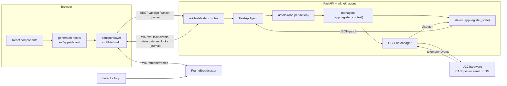
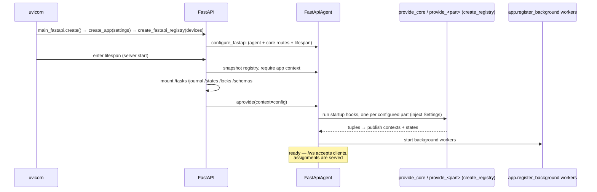

# newswitch Architecture & Developer Guide

*How the backend, the arkitekt stack, and the frontend fit together. Written
against `arkitekt` 8.0.0, `arkitekt-runtime` 5.0.0, `arkitekt-spec` 3.18.0 and
`arkitekt-fastapi` 2.1.0, pinned exactly in `backend/pyproject.toml`
(2026-10). newswitch was built on rekuest-next before; that stack is gone.
File references are relative to the repo root.*

---

## 1. The big picture

newswitch is a FastAPI app whose entire functional surface is managed by an
**arkitekt agent** embedded in the server. Nothing in the backend defines
REST endpoints for microscope features by hand. Instead, everything is registered
on an app registry, `App("newswitch", app_context=Settings)`, which
`create_registry` (`backend/newswitch/microscope/registry.py`) creates fresh for every app.
Nothing registers itself on import and nothing is held in a module: modules only
declare plain functions and plain `@dataclass` models/states (no decorators), and
`create_registry` imports them by name and registers them explicitly, according to
the device configuration (section 2.7):

- **functions** registered with `app.register_action` (in `create_registry`) become
  remotely callable **actions**,
- **data classes** registered with `app.register_state` become **reactive shared state**
  that is pushed to every browser as JSON-patches,
- **service classes** registered with `app.register_context` (the "managers") are
  **dependency-injected** into those functions by type annotation,
- the frontend **generates typed React hooks** from the backend's schemas
  (a committed export of a complete microscope, `frontend/schemas/`), so UI
  code never hand-writes API calls.

That is how `main_fastapi.py` serves it, the default. newswitch can also be served as a
plain **arkitekt agent** connected to an arkitekt server and shown in Orkestrator
(`main_arkitekt.py`); the microscope's registry is the same, only the
frames and the UI differ (section 6.1).

| Package | What newswitch uses from it |
|---|---|
| `arkitekt` | the `App` facade (the app registry), `Task`, `OptimisticInput`, `bsx`, `withValidator`, `model_field` |
| `arkitekt-runtime` | the agent, actors, locks, evented states, the journal |
| `arkitekt-spec` | the declarations (implementations, state/lock schemas, ports) |
| `arkitekt-fastapi` | the served agent: `configure_fastapi`, `/ws`, `/schemas/*`, journal routes, `AsyncAgentTestClient` |



---

## 2. arkitekt concepts, one by one

### 2.1 Agent and actors

arkitekt uses the classic **actor model**. Translated to newswitch:

- The **Agent** (`FastApiAgent`, created by `configure_fastapi` from
  `arkitekt_fastapi` in `backend/main_fastapi.py:create_app`) is the *runtime
  container* for the whole app. It does not do microscope work itself. It owns:
  - `contexts: dict` — the live manager instances (everything
    `app.register_context`), keyed by name (newswitch's own routes do not look
    them up here: they read them off the running agent's contexts, section 6),
  - `states: dict` — the live state instances (everything `app.register_state`),
    each with a revision counter and a serialized ("shrunk") copy,
  - `locks: dict` — named task locks (e.g. `stage_position`),
  - the **implementation map** — one entry per declared action,
  - the startup/shutdown hooks and background workers,
  - all running **assignments** (tasks) and the actors executing them,
  - the **journal** and a SQLite store (`arkitekt_agent.db`, `db_path` in
    `backend/base_config.yaml`) that persists it. The old `agent_data.db` of
    the rekuest-next days cannot be read by the new store.
- An **actor** is the execution vehicle for one implementation. When a client
  *assigns* a task ("run `move_stage` with these args"), the agent routes the
  assignment to the actor for that implementation, which runs the function
  (sync functions in a worker thread via koil, async ones on the loop) and
  reports lifecycle events back (`STARTED`, `PROGRESS`, `YIELD`, `PAUSED`,
  `HELD`, `CANCELLED`, `COMPLETED`, `FAILED`).

In upstream Arkitekt, the agent connects out to an arkitekt server and receives
assignments from there. In newswitch, **arkitekt-fastapi** replaces that
transport: the agent lives inside uvicorn and browsers talk to it directly over
`/ws` + a few REST routes. Same model, no external server. Served by
`main_arkitekt.py` (section 6.1) newswitch does connect out, as a plain
arkitekt agent.

### 2.2 The app context

`App("newswitch", app_context=Settings)` declares which class is the
**app context**: the one settings object of a deployment. `Settings`
lives in `backend/newswitch/settings.py` (a pydantic-settings class reading
`backend/base_config.yaml`). There is no marker decorator anymore; the
declaration on the `App` is all there is.

The object you pass as `app_context=` into `configure_fastapi` travels into
`agent.aprovide(context=...)` and becomes **injectable by type** into hooks and
actions. That's why the startup hooks (`provide_stage(app_context: Settings)`, …)
receive the config. The served app refuses to start without one: the lifespan calls
`require_app_context` before the agent is entered.

### 2.3 `app.register_startup` — the composition root

```python
# newswitch/microscope/parts.py: data and functions
parts = configured_parts(devices)          # Parts(stage=True, detector=True, ...), a value
build_microscope(settings, devices)        # -> Microscope: a record of every state and manager

# newswitch/microscope/registry.py, in create_registry:
built: list[Microscope] = []

def microscope(settings: Settings) -> Microscope:    # one build, on the first hook
    if not built:
        built.append(build_microscope(settings, devices))
    return built[0]

if parts.stage:
    async def provide_stage(app_context: Settings) -> Tuple[StageManager, StageState]:
        m = microscope(app_context)
        return m.stage, m.stage_state

    app.register_startup(provide_stage)
...
```

Startup hooks run **once, when the agent boots** (inside `aprovide`, before
anything is callable). Two pieces of magic, both driven purely by type
annotations:

1. **Parameter inspection**: each parameter is matched by its annotated type
   against (a) the app-context class, (b) already-published state classes,
   (c) already-published context classes. Matching objects are injected.
2. **Return annotation → publication**: the `Tuple[...]` return annotation
   tells the agent what each returned object *is*. Objects whose class/protocol
   is a context go into `agent.contexts`; objects whose class is a state go
   into `agent.states` (serialized, revision 0, immediately subscribable).

So `create_registry` is the **composition root**: it defines one startup hook per part
(`provide_core`, `provide_stage`, `provide_illumination`, `provide_detector`,
`provide_objective`, `provide_filter_bank`, `provide_uc2`, and `provide_focus` for the
focus group, stage + detector), closures with static `Tuple[...]` return annotations,
next to the registration of what they provide, only for the parts the configuration has.
Startup hooks get only the app context injected (no states or contexts exist yet) and
none sees what another returned, while the parts depend on each other (the simulated
detector reads four other states, acquisition and hooks use several managers, the UC2
parts share one bus). So all hooks hand out the objects of one `build_microscope`, made
on the first hook and kept in `create_registry`'s closure. A part the
configuration lacks is never constructed (on hardware nothing talks to the bus for
it); the states shared managers read of it (light path, metadata, the simulated
detector) stay empty. Everything a hook returns is "published for the rest of the
agent lifecycle" and becomes injectable into every action, background worker and
shutdown hook. If you build a new manager and forget to add it to both the return
*value* and the return *annotation*, injection will fail with
`StateRequirementsNotMet` at call time.

**context dependency** = "give me the live manager instance of this type"
(e.g. `stage: StageManager`). **state dependency** = "give me the live shared
state instance" (e.g. `state: StageState`). Contexts are never serialized;
states are.

`app.register_shutdown` hooks run when the agent tears down, after background
workers and running tasks are cancelled: `save_device_config` (if the microscope was started) writes runtime
values back into the device config, `close_detector` (`newswitch/actions/detector.py`)
releases the cameras.

### 2.4 `app.register_action` — actions

Any function becomes a remotely callable action:

```python
# newswitch/actions/stage.py: a plain function
def move_stage(stage: StageManager, task: Task, x: float | None = None, ...) -> None:
    stage.move(x=x, ..., task=task)

# newswitch/microscope/registry.py, in create_registry, when a stage is configured
app.register_action(stage.move_stage, optimistics=[OptimisticInput(state="StageState", path="/x", accessor="/x"), ...])
```

- Parameters that are contexts/states are injected (invisible to callers);
  everything else becomes the action's *argument schema* (a "port"), which is
  what the frontend codegen turns into a zod schema.
- **Progress and pause**: there is no ambient `progress()`/`pausepoint()`.
  An action takes an injected `task: Task` (from `arkitekt`) and calls
  `task.progress(pct, msg)` and `task.pausepoint()` — that's what powers the
  live progress bar and the pause/step buttons. Managers that report progress
  receive the task explicitly (`StageManager.move(..., task: Optional[Task] = None)`).
  Tests calling an action directly pass `Task.local()`.
- `locks=[...]` declares the action's locks explicitly; otherwise they are
  inferred from the contexts/states it takes (see 2.6 and section 5).
- `optimistics=[...]` describes how the UI should *predict* the state change
  before the backend confirms (instant slider/position feedback). `path` and
  `accessor` are JSON pointers.
- **Validators** on arguments are blok UtilCalls built with
  `withValidator("len(value) > 0", error_message=...)` (see
  `newswitch/models/acquisition.py`); the frontend
  evaluates them in `frontend/src/lib/arkitekt/calls.ts`.
- Nothing is registered at import time. A function becomes an action when
  `create_registry` calls `app.register_action(fn, ...)` on the registry it
  creates; importing a module has no side effects.

### 2.5 `app.register_background` — daemons

`app.register_background` functions are long-running workers started right after
the startup hooks (async ones run on the event loop, sync ones in a dedicated
thread). They use the same injection: `run_uc2_bus(uc2_bus: UC2BusManager)`
gets the live bus. newswitch has three: the detector acquisition loop, the UC2
bus connection pump, and the UC2 event → state dispatcher.

### 2.6 Registering classes

Models and states are plain `@dataclass`es; registering them does not change the
class, so any number of registries can take the same one.

| Registration | What it does |
|---|---|
| `app.register_context(locks=[...])` | Marks a class (usually a `Protocol`) as an **injectable service** ("manager"). `locks=[...]` are the locks every action taking this context holds. |
| `app.register_state(required_locks=[...])` | Introspects the class into a **state schema** (ports per field) and makes instances *evented*: every `setattr` applies the change under the state's own RLock and publishes a JSON-patch with a new revision to all subscribers. `required_locks` are the locks every action taking this state holds; writes themselves are not checked against locks. |
| `app.register_model` | Marks a dataclass as a **serializable data structure** so it can appear inside action arguments/returns and state fields. Its identifier is `@newswitch/<snake_name>`. Used for config/value objects (`StageConfig`, `Illumination`, `UC2CanBusConfig`, …). No reactivity. Enums travel by member name (`"SEQUENTIAL"`). |
| `@runtime_checkable` | Python stdlib `typing`, not arkitekt — allows `isinstance(obj, SomeProtocol)` structural checks, which the tests use (`isinstance(bus, UC2BusManager)`). |

### 2.7 The app registry and bloks

`app.registry` is the **AppRegistry** of an app — the accumulator for
everything above (implementations, state schemas, locks, bloks, hooks). There
is no global registry: `create_registry(devices, services=())` creates one and
registers everything on it explicitly, by name, based on the device configuration:

1. the models, always (`register_models(app)`);
2. the core every microscope has: io, hooks, expanse, calibration, light path,
   metadata, cache, the action `clear_expanse`
   (`provide_core`; on shutdown `save_device_config`, if it was started);
3. one group per configured part — stage, illumination, detector, objective,
   filter bank, UC2 board (a `uc2-rest` or `canopen` controller) — each with its
   states, contexts, startup hook, actions (`newswitch/actions/<part>.py`) and
   background tasks;
4. what needs several parts, when all are there: the focus group (stage + detector,
   `parts.focus`: the state `AutofocusState` from `provide_focus`, and
   `run_autofocus`, `calibrate_light_path`, `scan_region`);
   `acquire_multidimensional_acquisition` (stage + detector + illumination);
   `run_uc2_event_dispatch` (UC2 board + stage).

The detectors send their frames to the context `FrameSink` (a runtime-checkable
protocol, `newswitch.broadcasters.FrameSink`), which the core registers but does not
provide: the entry file provides it, with a startup hook of its own, and passes in the
arkitekt `services` the `App` is created with. The background `run_detector_loop(detector:
DetectorManager, sink: FrameSink)` gets both contexts injected and calls
`detector.acquire_live(sink)`. The registry has no UI and no way to watch the frames
yet: the entry file registers those on the returned app (section 6.1). Without a configuration only the models and the core are registered:
`clear_expanse` is the only action. Every call builds its own microscope, so two apps
in one process share nothing:

```python
def create_registry(devices: NewswitchConfig | None,
                    services: Sequence[Service[Any]] = ()) -> App:
    app = App("newswitch", app_context=Settings, services=services, root=ASSET_ROOT)
    parts = configured_parts(devices)
    built: list[Microscope] = []
    def microscope(settings: Settings) -> Microscope: ...  # build_microscope(settings, devices), once
    register_models(app)
    app.register_state(IOState, required_locks=[locks.IO])  # ... the core
    app.register_context(FrameSink)                        # provided by the entry file
    app.register_startup(provide_core)                     # closures over microscope()
    app.register_action(core.clear_expanse)
    if parts.stage:
        app.register_state(StageState, required_locks=[locks.STAGE])
        app.register_context(StageManager, locks=[locks.STAGE])
        app.register_startup(provide_stage)
        app.register_action(stage.move_stage, optimistics=[...])
    ...                                                    # illumination, detector, ...
    if parts.focus:                                        # stage + detector
        app.register_state(AutofocusState)
        app.register_startup(provide_focus)
        app.register_action(scan_region)                   # run_autofocus, calibrate_light_path
    return app

# main_fastapi.py: the transport and the UI, on top
async def provide_frame_broadcaster(app_context: Settings) -> Tuple[FrameSink]:
    return (FrameBroadcaster(),)             # the detectors' sink: the live view's broadcaster

def create_fastapi_registry(devices: NewswitchConfig | None) -> App:
    app = create_registry(devices)
    app.register_startup(provide_frame_broadcaster)
    declare_ui(app, devices)                 # the config's ui
    return app
```

The configuration's bloks are validated strictly against what was registered: a
blok calling an action whose device is absent is refused.

You can register **any function** whose non-injected parameters are
serializable types — that's how a new "app" (in the ImSwitch sense) gets its
backend surface. When the server starts, the agent serves a validated, frozen
**snapshot** of the registry.

A blok is different: it ships a **server-defined UI fragment** written in a
JSX-like markup. Bloks are not written in Python: they are the `ui` section of the
device configuration, checked against the catalog the frontend publishes
(`newswitch/bloks/newswitch-catalog.json`, versioned as `newswitch@<n>`). Bloks are served at
`/schemas/bloks` and read by the frontend **at run time** (nothing about the UI is
built in): it fetches them when it connects, and again on reconnect, and renders
them with its blok renderer (`@arkitektio/bsx`).

A blok's Tailwind classes are compiled **in the browser** (`@arkitektio/bsx/tailwind`, the
Tailwind compiler fed the app's tokens and variants from `frontend/src/theme.css` by
`src/lib/blok/platform.ts`), since
the build never sees them. Bloks
can style by situation with three variants:
- `past:` / `live:` — the app shows the replay timeline, or the live microscope;
- `locked:` — a control (or a microscope panel) whose action a held lock keeps from
  running now, e.g. `<StageControl className="locked:opacity-60" />` during a move.
  A locked control is marked, not disabled. The UI is the device configuration's `ui`
section (`backend/configs/README.md`); one built from an optikit design (the microscope in
3D, see `newswitch.design`) is written by `just build-design`. Bloks are written in blok
language v2: they bind to states (`{self.ObjectiveState.mounted_lenses}`), loop
(`<foreach>`), and invoke actions (`onClick={self.switch_objective(slot: lens.slot)}`).
The backend serves their source, and the frontend parses it (`@arkitektio/bsx`). Use them for
small panels that shouldn't require a frontend build.

---

## 3. Boot lifecycle, step by step

What happens when you run `uvicorn main_fastapi:create --factory --port 8099`:

1. **`main_fastapi.create()`** (uvicorn calls the factory, on every reload again):
   `newswitch.settings.load_settings()` reads `base_config.yaml`, optionally replaced by the
   file `NEWSWITCH_CONFIG` names, and `create_app(settings)` runs. Importing
   modules registers nothing.
2. **`create_app`** builds the FastAPI app, adds auth and CORS middleware, reads
   the device configuration (`load_devices(config, "ui")`), creates the registry
   (`create_fastapi_registry(devices)`: `create_registry(devices)`, the startup hook
   `provide_frame_broadcaster` that provides a `FrameBroadcaster` as the `FrameSink`,
   `declare_ui`), then calls
   **`configure_fastapi(app=app, app_registry=registry.registry, expand_user_from_request=..., app_context=config, db_file=config.db_path)`**
   which:
   - constructs the `FastApiAgent` with the registry + SQLite sink/retriever,
   - mounts the *core* surface immediately: `/ws` (the single multiplexed
     websocket for task events, state patches and lock events) plus
     `/assign`, `/cancel`, `/pause`, `/resume`, `/step`,
   - builds a **lifespan** context manager and installs it via
     **`app.router.lifespan_context = lifespan`**. This is plain FastAPI
     machinery: the lifespan is an async context manager that uvicorn enters
     after binding the port ("startup") and exits on shutdown. arkitekt-fastapi
     *replaces* the app's default lifespan so agent boot/teardown ride on the
     server's own lifecycle.
3. Back in `create_app`, the non-agent routers are mounted: auth and accounts
   (`newswitch/accounts/routes.py`), then the routes of `newswitch/routes/`:
   the module-level routers `newswitch.routes.liveview.router` at `/stream` (video
   websockets, from the running agent's `FrameBroadcaster`), `newswitch.routes.files.router`
   and `newswitch.routes.cache.router`.
4. **Server startup → lifespan enters**:
   - the agent swaps its registry for a frozen snapshot and checks the app
     context is there (`require_app_context`),
   - the remaining route groups are mounted (`/tasks`, the journal routes,
     `/states`, `/locks`, per-implementation execution routes, `/assets`, and
     the **schema routes** (the frontend's export, `just export-schemas`, is
     exactly what they serve, taken from a registry snapshot without a server):
     `/schemas/implementations`, `/schemas/states`, `/schemas/locks`,
     `/schemas/bloks`, `/schemas/assets`),
   - OpenAPI is configured, `app.state.agent = agent`,
   - `async with agent:` opens the agent, then **`agent.aprovide(context=config)`**
     is spawned as a task. `aprovide`:
     1. runs every **startup hook** (→ the first `provide_<part>` closure, via `build_microscope`,
        builds the managers and states of all configured parts, choosing virtual vs
        UC2 transport from the config; each hook returns its part's; the entry file's
        `provide_frame_broadcaster` provides the `FrameSink`),
     2. publishes the returned contexts and states,
     3. starts every **background worker** (detector loop, `run_uc2_bus`,
        `run_uc2_event_dispatch`),
     4. begins serving assignments.
5. **Shutdown** reverses it: the provide task is cancelled → background tasks
   cancelled (that's the `CancelledError` path your bus `abackground` must
   re-raise) → running tasks cancelled → **shutdown hooks** run
   (`save_device_config`, `close_detector`) → agent closes → app exits.



---

## 4. Request lifecycle (what a button press does)

1. A component calls a generated hook (`useMoveStage().call({x: 100})`).
2. The transport POSTs to **`/assign`** with the implementation name and args;
   the args were validated client-side against the generated zod schema (and
   any `withValidator` calls).
3. The agent records the assignment and hands it to the actor. If another
   running action holds one of the action's **locks**, it waits until that
   lock is released; then the function body runs with its contexts/states and
   `task` injected.
4. Lifecycle events (`STARTED`, `PROGRESS`, …) and `LOCK`/`UNLOCK` frames
   stream to every subscribed client over **`/ws`**; the UI's
   `ProgressDisplay`/lock indicators react. Other clients see the task too
   (`ASSIGN`).
5. Any state mutation inside the call (or from elsewhere, e.g. the UC2
   dispatcher writing `StageState.x`) is JSON-patched over the same socket.
6. Cancel/pause/step buttons hit `/cancel`, `/pause`, `/step`;
   `task.pausepoint()` in the function body is where pauses take effect;
   cancellation raises `CancelledError` inside the body (the UC2 bus turns
   that into a hardware stop command).
7. Every event lands in the **journal**, persisted to SQLite (→ `/replay`).

---

## 5. State, locks and the journal

- A state instance is a normal Python object — **mutating an attribute is
  the entire API** (`stage_state.x = 42.0`). The evented subclass publishes
  `{op: replace, path: /x, value: 42.0, rev: n}` to the agent, which fans it
  out to `/ws` subscribers; each frontend zustand store applies patches in
  revision order. Thread safety of the write is the state's own RLock.
- **Locks are action locks, nothing else.** An action's locks are its
  explicit `locks=` or are inferred from the contexts/states it takes (a
  state's `required_locks`, a context's `locks`). They do two things: an
  action waits until no other running action holds the same lock (real
  mutual exclusion — command exclusivity over a device for a whole
  multi-step operation), and the UI is told (`LOCK`/`UNLOCK`) so it can
  disable conflicting actions. The names are the constants of
  `newswitch/microscope/locks.py`, one per part (and shared service): `STAGE`
  (`"stage_position"`), `ILLUMINATION`, `DETECTOR` (`"camera_parameters"`),
  `OBJECTIVE`, `FILTER_BANK`, `GALVO`, `IO`, `HOOKS` (`"hook_registry"`),
  `EXPANSE` (`"expanse_state"`), `CACHE`; each part's state and manager carry
  its lock (the `ObjectiveManager` holds `OBJECTIVE`), the `AcquisitionManager`
  holds `EXPANSE` and `IO`, and the UC2 actions name theirs explicitly.
- **State writes are not checked against locks.** Managers, background loops
  (the UC2 event dispatch) and shutdown hooks write states freely. Writes made
  inside an action through the injected state are attributed to the task
  (the patch carries its `task_id`) and are refused after the task ended;
  writes made by managers or hooks directly carry no task id.
- `optimistics=[OptimisticInput(state=..., path="/x", accessor="/x")]` on
  `app.register_action` lets the UI apply a *predicted* patch immediately when the
  call is made; the real patch reconciles it.
- The **journal** is one ordered record per agent session. Every entry has a
  `pos` (1, 2, 3 … no gaps), a `global_rev`, a `kind`, a `task_id`, …; the
  world at any position is states + tasks + locks. It is served at
  `/journal`, `/journal/{session}`, `/journal/{session}/at/{pos}`,
  `/journal/{session}/at?timestamp=…` and `/tasks/{id}/events`. (The older
  `/states/checkout`, `/states/segments` and session boundary routes still
  exist, but the frontend no longer uses them.)

---

## 6. Video streaming (separate from /ws)

Bulk pixels never travel through the state system. The detector background
loop (`run_detector_loop`, `detector.acquire_live(sink)`) pushes frames into the
**`FrameBroadcaster`** (`backend/newswitch/broadcasters/`; the `FrameSink` `main_fastapi.py` provides),
which keeps the newest frame per slot. Browsers open `WS /stream/frames/{slot}`
(`backend/newswitch/routes/liveview.py`, its `router` included by `create_app`;
the first message is the client's auth frame) and get whole frames, one per message: a
header and the detector's own values (`newswitch/broadcasters/wire.py`), binned to
`max_size` (default 640; 0 sends full size), byte-shuffled and zstd-compressed, which is
lossless. The client acknowledges each frame and is sent
the newest one after that, so a slow viewer skips frames and one can join at any time; without
this the server would buffer what a client has not taken yet, without limit. uvicorn runs with
`--ws-per-message-deflate false`: its own compression of every frame takes a core and most
of the frame rate. The frontend shares one socket per slot and size per tab
(`frontend/src/components/liveview/frameStream.ts`). Scan/acquisition code
can broadcast into additional slots (e.g. stitched-map tiles).

### 6.1 Two ways to serve

The detectors only know the **`FrameSink`** protocol
(`backend/newswitch/broadcasters/sink.py`: `start_broadcasting()`,
`broadcast_sync(slot, frame)` from the detector's thread), a context `create_registry`
registers and the entry file provides. Which sink they get, and which UI is declared,
is up to the entry file: both start the same way (`backend/main.py`: settings, then
`load_devices(config, "ui" | "agent_ui")`, which raises `ConfigError` when the device
configuration lacks that UI section), call `create_registry(devices, services=())`, then
register on the returned app what is particular to them, among it a module-level
startup hook that provides the `FrameSink` (`python main.py fastapi|arkitekt` picks one).

| | `backend/main_fastapi.py` | `backend/main_arkitekt.py` |
|---|---|---|
| Run | `uvicorn main_fastapi:create --factory`, `just dev` | `python main_arkitekt.py`, `just agent` |
| Registry | `create_fastapi_registry(devices)` → `App` | `create_arkitekt_registry(devices)` → `App` |
| Sink | `FrameBroadcaster` (`newswitch/broadcasters/`), provided as the `FrameSink` | `LovekitSink(cameras_of(devices))` (`newswitch/broadcasters/lovekit.py`), provided as the `FrameSink`; `services=(lovekit_service,)` |
| Registers | startup `provide_frame_broadcaster` → `Tuple[FrameSink]` | state `CameraStreams`, startup `provide_lovekit_sink` → `Tuple[FrameSink, CameraStreams]`, background `publish_camera_streams` (when there are detectors) |
| UI | config `ui`, newswitch frontend's catalog (`declare_ui`) | config `agent_ui`, Orkestrator's standard catalog (`declare_agent_ui`) |
| Frames | `WS /stream/...` (above) | lovekit streams, one per detector |
| Mikro | Configured by hand: `MIKRO_URL`, `MIKRO_DATALAYER_URL`, `MIKRO_TOKEN` (`newswitch/services/mikro_connection.py`); unset runs without one. Compose has a stack for it: `just mikro` | `mikro_service`: the one the arkitekt server provides |
| HTTP routes | auth, accounts, `newswitch/routes/`: live view, files, cache | none |

`create_app` includes the module-level routers of `newswitch/routes/`:
`liveview.router` at `/stream`, `files.router` (`/files/...`) and `cache.router`
(`/cache/...`). All read what they need off the running agent's contexts
(`running_context(connection, cls)` in `routes/__init__.py`, for requests and
websockets): files the `IOManager`, cache the `CacheManager`, the live view the
`FrameBroadcaster` (provided as the `FrameSink`). Before startup the HTTP routes answer
503 and the live-view websocket closes with 1013.

`main_arkitekt.py` runs the registry with `arkitekt.run`, which logs in to the arkitekt
server fakts finds (`--url` / `$FAKTS_URL`); it needs the extra `agent`
(`arkitekt[rekuest,lovekit]`, `uv sync --extra agent`), and only it imports lovekit
(`newswitch.broadcasters` does not import `lovekit.py`).
Each configured detector becomes a lovekit `VideoStream`, keyed by its key in the
device configuration (stable across restarts) and titled by its name (`cameras_of(devices)`
→ `list[CameraStream]`). The startup hook `provide_lovekit_sink` provides a
`LovekitSink(cameras_of(load_devices(app_context)))` as the `FrameSink`, and a
`CameraStreams`. The `LovekitSink` keeps the newest frame per detector; the background
hook `publish_camera_streams(lovekit, sink: FrameSink, live: CameraStreams)` (a sink
that is not a `LovekitSink` is refused with a `TypeError`) sends what is new, at most `MAX_FPS` (15) per stream,
converting with `to_rgba` off the event loop (~37 ms per 1920×1200 frame). The
declared streams are held in the state `CameraStreams`, which the `agent_ui` bloks
show (`<StructureDisplay value="@stream" />`). The `agent_ui` is checked strictly,
offline, against the catalog arkitekt ships (`orkestrator@v4.2.1`) and the registry
(`declare_agent_ui`); a configuration without one does not start as an agent.
The agent serves no HTTP routes: the files the IO manager writes and the frame
cache are not reachable from Orkestrator, so a frame's cache id or a file handle
points nowhere there (a known gap). So far the agent is tested offline only, with
a fake lovekit client.

---

## 7. Module reference (backend)

| Path | Role |
|---|---|
| `main.py` | **Start here**: the steps both ways of serving share. `load_devices(config, "ui" \| "agent_ui")`: the device configuration of the settings, `ConfigError` without that UI section; `python main.py fastapi\|arkitekt`. |
| `main_fastapi.py` | Served by FastAPI: the startup hook `provide_frame_broadcaster` (a `FrameBroadcaster` as the `FrameSink`), `create_fastapi_registry(devices)` → `App` (`create_registry`, that startup hook, `declare_ui`), `create_app` (`configure_fastapi`, auth, accounts, the routers of `newswitch/routes/`), the uvicorn factory `create`, `main`. |
| `main_arkitekt.py` | Served as an arkitekt agent: `cameras_of(devices)`, the startup hook `provide_lovekit_sink` (a `LovekitSink` as the `FrameSink`, and `CameraStreams`), `create_arkitekt_registry(devices)` → `App` (`create_registry` with `lovekit_service`, the state `CameraStreams`, that startup hook, `publish_camera_streams`, `declare_agent_ui`), `create(settings)`, `main` (`arkitekt.run`). |
| `newswitch/tools/` | Tools beside the servers: `build_design.py` (`just build-design`), `export_schemas.py` (`just export-schemas`: `create_registry` on `REFERENCE_CONFIG`, its registry snapshot written to `frontend/schemas/`), `accounts.py` (account recovery from a shell). |
| `newswitch/settings.py` | `Settings` (the app context), read from `base_config.yaml` (among its fields `image_dir`, `cache_dir`), and `load_settings` / `load_devices`: the settings and device configuration both servers start from. |
| `newswitch/microscope/registry.py` | `create_registry(devices, services=())`: creates a fresh `App("newswitch", app_context=Settings, services=services)` and explicitly registers, by name, the models (`register_models`), the core (with the context `FrameSink`, which the entry file provides), one group per configured part and the multi-part actions; no UI, no streams (the entry files add those). |
| `newswitch/microscope/parts.py` | Data and functions: `configured_parts(devices)` → `Parts` (which parts; `focus` = stage + detector), `build_microscope(settings, devices)` → `Microscope` (a record of every state and manager, absent parts None), from `build_uc2_bus`, `build_stage`, `build_illumination`, `build_objective`, `build_filter_bank`, `build_detector_manager`; `save_device_config(settings, microscope)`. The startup hooks are closures in `create_registry`. |
| `newswitch/microscope/locks.py` | The lock names, one constant per part (and shared service): `STAGE` = `"stage_position"`, `ILLUMINATION`, `DETECTOR` = `"camera_parameters"`, `OBJECTIVE`, `FILTER_BANK`, `GALVO`, `IO`, `HOOKS` = `"hook_registry"`, `EXPANSE` = `"expanse_state"`, `CACHE`. |
| `newswitch/routes/` | The routes `main_fastapi.py` serves beside the agent (section 6.1), each a module-level `router`: `liveview.py` (`/stream` websockets, from the running `FrameBroadcaster`), `files.py` (`/files/...`, the `IOManager`), `cache.py` (`/cache/...`, the `CacheManager`); `__init__.py`: `running_context(connection, cls)`, the running agent's context for a request or websocket (503 before startup; the live view closes with 1013). |
| `newswitch/actions/` | Plain action, background and shutdown functions, one module per part, registered by `create_registry` only when the part is configured: `core.py` (`clear_expanse`), `stage.py`, `illumination.py`, `detector.py` (also `run_detector_loop`, `close_detector`), `objective.py`, `filter_bank.py`, `uc2.py` (home/stop/LED/galvo/node-scan actions, `run_uc2_bus`, `run_uc2_event_dispatch`). |
| `newswitch/routines/` | Multi-step procedures registered as actions: `region_scan.py`, `multidimensional_acquisition.py`, `calibration.py`, `autofocus.py`; `common.py` holds what they share (`z_sweep`, `field_of_view`, `acquire_step`). The template for porting ImSwitch "apps".; `affine_matrix.py` (pixel shifts, the pixel→stage affine). |
| `newswitch/protocols/` | The **contracts**: the manager protocols only (`app.register_context`), one module per part or service — `stage`, `illumination`, `detector` (+ `DetectorFrame`), `objective`, `filter_bank`, `uc2` (`UC2BusManager`), `acquisition`, `cache`, `calibration`, `expanse`, `io`, `light_path`, `metadata`, `hook_manager` (+ `HookContext`, `UnsupportedHook`). |
| `newswitch/states/` | The states (`app.register_state`), one module per state: `StageState`, `IlluminationState`, `CameraState`, `ObjectiveState`, `FilterBankState`, `UC2State`, `IOState`, `HookState`, `ExpanseState`, `CalibrationState`, `LightPathState`, `AutofocusState`. |
| `newswitch/models/` | The value types (`app.register_model`): `light_path.py` (Kube/light-path optics model, `LightPathSnapshot`), `frames.py` (`Frame`, `Image`, `Metadata`), `devices.py`, `hooks.py`, `calibration.py`, `io.py`, `uc2.py` (typed hardware events), `acquisition.py` (`MultidimensionalAcquisition`, `StreamIllumination`, `Stack`, …). |
| `newswitch/drivers/virtual/` | Full simulation implementations (stage, LED, detector, objective, filter bank); `simulation/` renders the frames (sample, synthetic PSF, defocus, noise). |
| `newswitch/drivers/uc2/` | Real hardware: `canopen_bus.py` / `rest_bus.py` / `virtual_bus.py` (transports behind `UC2BusManager`), `event_broker.py` (fan-out), `dispatch.py` (events → states), plus bus-based device managers (`stage_manager.py`, `illumination_manager.py`, `objective_manager.py`, `filter_bank_manager.py`) and `uc2_detector.py` (real cameras through uc2_cam_py). |
| `newswitch/services/` | The managers every microscope shares: `acquisition.py`, `cache/`, `calibration.py`, `expanse.py`, `io/`, `light_path.py`, `metadata.py`, `hooks/` (`manager.py`: `PythonHookManager`; `software_autofocus.py`). |
| `newswitch/broadcasters/` | The `FrameSink` protocol (`sink.py`, runtime-checkable; the context the detectors stream to, provided by the entry file), `FrameBroadcaster` (`frame.py`, the newest frame per slot) and the live view's message format (`wire.py`) for `main_fastapi.py`; `lovekit.py` for `main_arkitekt.py` (`LovekitSink`, `CameraStream`, `CameraStreams`, `publish_camera_streams`, `MAX_FPS`; not imported by the package). |
| `newswitch/accounts/` | Users and auth of the FastAPI server: `auth.py` (login, tokens, middleware), `store.py` (the account database), `routes.py` (account management). (Live view, files and cache are in `newswitch/routes/`.) |
| `newswitch/reference/complete-microscope.yaml` | The reference microscope: every part, devices only (no `ui`); what the frontend's schemas are exported from. |
| `configs/` | Device configuration read via `base_config.yaml` (`newswitch-config.yaml`, generated schema in `schemas/`, see `configs/README.md`) and whole-microscope setup files loaded via `NEWSWITCH_CONFIG` (`uc2_serial.json`, `uc2_canopen.json`). |
| `tests/` | pytest; agent-level tests drive the app through `AsyncAgentTestClient` (`arkitekt_fastapi.testing`). |

### The "controller/manager/widget" mapping for ImSwitch veterans

| ImSwitch | newswitch |
|---|---|
| `FooController` + `@APIExport` | `app.register_action` functions (in `actions/` or `routines/`) |
| `FooManager` (device) | `app.register_context` Protocol in `protocols/` + implementation in `drivers/` (or `services/`) |
| `CommunicationChannel` signals | `app.register_state` mutations (auto-broadcast) |
| `MasterController` | `build_microscope` (`newswitch/microscope/parts.py`), handed out by one `app.register_startup` hook per configured part (`create_registry`) |
| React widget + Redux slice + axios file | one component using **generated** hooks |
| setup JSON `availableWidgets` | `Settings` / `NEWSWITCH_CONFIG` file + which parts `configured_parts` finds (`build_microscope` builds, `create_registry` registers) |

---

## 8. The UC2 hardware layer

`protocols/uc2.py` defines the transport-agnostic **`UC2BusManager`**: stage
verbs in micrometers, laser/LED in raw PWM, galvo in DAC counts, objective
slots, node scan — plus `subscribe()` yielding typed events
(`models/uc2.py`: `PositionUpdate`, `MotionDone`, `HomingChanged`, `EStopChanged`,
`ButtonPressed`, `NodeSeen`, `BusError`).

Three interchangeable implementations (selected in `build_uc2_bus` from
`uc2_transport`): **`UC2CanBus`** (CANopen via `uc2canopen.aio`; node map,
µm↔steps scaling, event-driven motion-done from TPDO frames), **`UC2RestBus`**
(serial JSON via `uc2rest.aio`; single ESP32 master, pattern-keyed firmware
events), **`VirtualUC2Bus`** (simulator). Both real buses reconnect with
exponential backoff and surface failures as `BusError` + `UC2State.last_error`.

Two background workers keep it alive: `run_uc2_bus` (owns the connection and
event pump) and `run_uc2_event_dispatch` (consumes `subscribe()` and mirrors
telemetry into `StageState`/`UC2State` — the §6.4 "spontaneous events" path).
The dispatcher writes freely, without a lock and without a task id, so the
reported position streams in while a move holds `stage_position`. Device
managers (`UC2StageManager`, …) only ever call bus verbs.

---

## 9. What is the *Expanse*?

The Expanse is newswitch's **infinite sample-space canvas** — the world map of
everything that has been imaged. `ExpanseState` (`states/expanse.py`) holds
placed `Image`s, each with its stage-space affine transform (position, pixel
size, orientation come from the `MetadataManager`/Kube optics model: the 4×4
pixel→stage affine `calibrate_light_path` measured for the frame's light path, or
without one the nominal pixel size, the detector's `pixel_size_um` / the
objective's magnification).
`ExpanseManager` adds/clears entries; acquisitions push their frames into it.
The frontend renders it as the three.js scene in `frontend/src/components/stage/`
(planes textured from zarr tiles, camera navigation). `clear_expanse` is the
registered action that empties it. Conceptually it replaces ImSwitch's
StageMap: a persistent, transform-correct mosaic of acquired FOVs.

---

## 10. Frontend in one paragraph

What a backend registers depends on its device configuration
(`create_registry`), but the frontend's hooks must cover everything newswitch
can do. So `just export-schemas` (`uv run python -m newswitch.tools.export_schemas`) builds
`create_registry` in-process on the reference microscope
`backend/newswitch/reference/complete-microscope.yaml` (`REFERENCE_CONFIG`: every
part, devices only, no `ui`; it refuses a configuration missing any part), takes a
snapshot of the registry — nothing is started, no app, no startup hooks — and writes
exactly what a FastAPI backend on it serves at `/schemas/implementations|states|locks`
into the committed `frontend/schemas/{implementations,states,locks}.json` — the
mirror of the blok catalog, which the frontend exports for the backend.
`frontend/plugins/generate-app.ts` (a Vite plugin, run on every dev/build)
reads only those files (paths set in `vite.config.ts`; no backend needed, a missing
file fails the build and points at `just export-schemas`) and emits
`src/apps/default/hooks/{actions,states,locks}/*.ts` — zod schemas + typed
hooks (`useMoveStage`, `useStageState`, …). Bloks are not generated: they are
read at run time (`src/lib/blok/backendUi.tsx`).
The export and the generated files are committed; `just drift-check` (and the
`codegen-drift` CI job) re-exports, rebuilds and fails if `frontend/schemas`,
`frontend/src/apps` diverge from what is committed. The hand-written runtime (`src/lib/arkitekt/`, formerly
`src/lib/rekuest`) manages the `/ws` connection, task assignment, patch
application and locks. Its INIT opts into the journal (`journal: true`):
frames then carry `pos` and `journal_session`, and on reconnect the client
sends `resume_after`/`session_id` and receives exactly the frames it missed (a
`resumed` INIT keeps local state; `resync: true` means start over). It also
handles `ASSIGN` (tasks started by other clients), `HELD` (status "held"),
`SESSION_INIT`/`STATE_SNAPSHOT` (state baselines) and accepts
`EFFECT`/`SHELVE`/`UNSHELVE`. The `/replay` page's timeline spans the current
journal session and shows states and locks at the selected time via
`/journal/current/at?timestamp=` (`checkoutAt` in the state context). Bloks
are rendered by the frontend's blok renderer. Components
(`src/components/microscope/*`) consume only the generated hooks. If you
add/rename a backend action, state or lock: `just export-schemas`,
`cd frontend && yarn build` (or just `just drift-check`), commit the
regenerated files.

---

## 11. Glossary

| Term | Meaning |
|---|---|
| **App** | An app registry (`arkitekt.App`), created per app by `create_registry`; its `registry` is what the agent serves. |
| **Agent** | Runtime container managing contexts, states, locks, actors, assignments, the journal. One per app; embedded in FastAPI here. |
| **Actor** | Executor for one registered implementation; handles one assignment at a time, reports lifecycle events. |
| **Assignment / task** | One invocation of an action, with id, args, lifecycle events, journaled history. Injected into the action as `task: Task`. |
| **Implementation** | The registered form of a function: name + argument/return ports + locks + optimistics. |
| **Port** | Typed slot in a schema (an argument, return value, or state field). |
| **Shrinking / expanding** | arkitekt's serialization (Python object → JSON) / deserialization. |
| **Context** | Injectable long-lived service object (`app.register_context`), a.k.a. manager. |
| **State** | Reactive shared data object (`app.register_state`); mutations broadcast as revisioned JSON-patches. |
| **App context** | The one config object (`Settings`, declared on `App(..., app_context=...)`) passed at boot and injectable by type. |
| **Lock** | Named action lock: actions holding the same lock never run at the same time; surfaced to the UI as LOCK/UNLOCK. Does not gate state writes. |
| **Journal** | One ordered record (`pos` 1, 2, 3 …) per agent session; the world at any position is states + tasks + locks. Backs reconnect/resume and `/replay`. |
| **Blok** | Server-defined UI fragment (JSX-like `bsx` markup) rendered by the frontend without a frontend build. |
| **Expanse** | Stage-space canvas of all placed/acquired images (the world map). |
| **Kube / light path** | Optics graph model (objective/filter/detector cubes with affine transforms) used to derive per-image metadata. |
